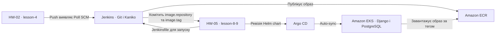
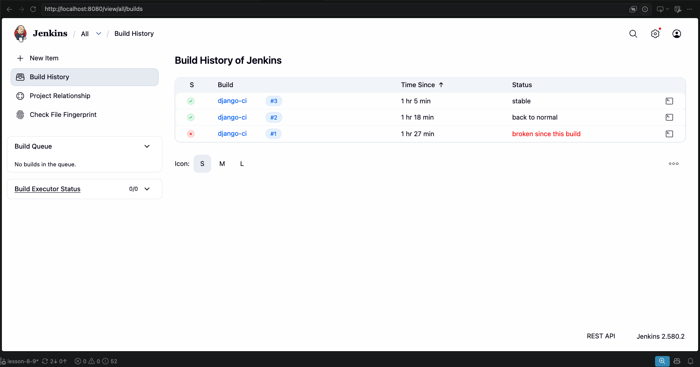
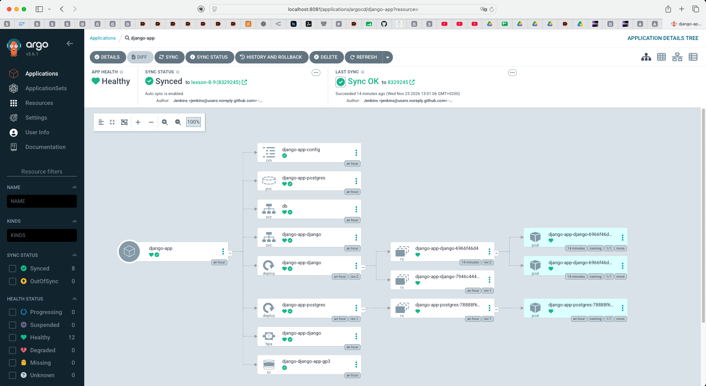
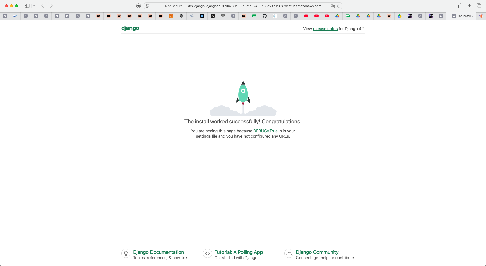

# CI/CD для Django в AWS EKS

## Опис проєкту

Навчальний проєкт реалізує CI/CD для Django в Amazon EKS у регіоні `us-west-2`. Terraform встановлює Jenkins і Argo CD через Helm. Jenkins публікує образ у ECR і записує його тег у Git. Argo CD автоматично синхронізує Helm chart, а вузли EKS завантажують образ з ECR.



Terraform створює VPC із public/private subnets, Internet Gateway, один NAT Gateway, ECR repository, кластер EKS `1.35` і чотири робочі вузли `t3.small`. Docker image Django зберігається в ECR. Helm chart розгортає Django, передає змінні середовища через ConfigMap і відкриває HTTP-доступ через публічний Network Load Balancer.

PostgreSQL працює в одному pod із постійним диском EBS `1Gi`. HPA керує кількістю Django pods у межах 2–6 із цільовим середнім CPU utilization 70%. Terraform state зберігається в S3, блокування забезпечує DynamoDB. Після демо інструкція передбачає повне видалення створених ресурсів.

## Орієнтовний кошторис

Оцінка для двогодинного демо в `us-west-2`, включно зі створенням і видаленням ресурсів. Нижче наведено округлені орієнтовні ставки станом на `2026-11-19` до врахування Free Tier і credits.

| Ресурс | Кількість та орієнтовна ставка | За 2 години, USD |
| --- | --- | --- |
| EKS зі standard support | 1 кластер × $0.10/год | 0.20 |
| EC2 `t3.small` | 4 вузли × близько $0.021/год | 0.168 |
| NAT Gateway | 1 × близько $0.045/год | 0.09 |
| Network Load Balancer | 1 × близько $0.0225/год | 0.045 |
| Public IPv4 | 3 адреси NLB та 1 NAT EIP × $0.005/год | 0.04 |
| EBS | 80 GiB root-дисків, 8 GiB Jenkins та 1 GiB PostgreSQL | близько 0.01 |
| **Базова вартість** | | **близько 0.55** |

Додатково оплачуються обробка traffic через NAT Gateway, NLB capacity units, передавання даних, зберігання та API-запити ECR/S3/DynamoDB, можливі T3 CPU credits. Практичний орієнтир для короткого демо — **$1–2**. Фактична сума залежить від часу роботи й обсягу використання. Перед запуском звірте регіональні тарифи, після демо виконайте cleanup у пунктах 6–9. [EKS](https://aws.amazon.com/eks/pricing/), [EC2](https://aws.amazon.com/ec2/instance-types/t3/), [NAT та IPv4](https://aws.amazon.com/vpc/pricing/), [NLB](https://aws.amazon.com/elasticloadbalancing/pricing/), [EBS](https://aws.amazon.com/ebs/pricing/), [AWS Calculator](https://calculator.aws/).

## Місткість EKS

Оцінка за Kubernetes requests для одного Jenkins build і Django на верхній межі HPA. Для Django враховано сім pods під час rollout або шість pods і Job міграцій, а також PostgreSQL.

| Компонент | CPU | Пам’ять | Pods |
| --- | ---: | ---: | ---: |
| Jenkins controller | 250m | 768 MiB | 1 |
| Jenkins agent з Git і Kaniko | 400m | 832 MiB | 1 |
| Django і PostgreSQL | 800m | 1 152 MiB | 8 |
| Бюджет для Argo CD | 500m | 640 MiB | 6 |
| EKS і add-ons, оцінка | 1 000m | 768 MiB | 17 |
| **Разом** | **2 950m** | **4 160 MiB** | **33** |

За типової конфігурації VPC CNI один `t3.small` підтримує до `3 × (4 − 1) + 2 = 11` pods. Чотири вузли дають 44 місця під pods. Оцінка враховує `aws-node`, `kube-proxy` і `ebs-csi-node` на кожному вузлі. [Ліміти ENI та IPv4 для EC2](https://docs.aws.amazon.com/ec2/latest/instancetypes/gp.html), [вибір типу інстанса для EKS](https://docs.aws.amazon.com/eks/latest/userguide/choosing-instance-type.html).

Під час демо кожен вузол мав близько 1 432 MiB `Allocatable`. Після розгортання Django найбільший залишок пам’яті за requests на одному з трьох вузлів становив близько 752 MiB. Jenkins agent потребував 832 MiB і залишився `Pending` із причиною `Insufficient memory`. Для розміщення агента Terraform задає групу з чотирьох вузлів. Фактичний запас видно в `Allocatable` та `Allocated resources` у `kubectl describe nodes`. [Розрахунок allocatable memory для EKS](https://docs.aws.amazon.com/batch/latest/userguide/memory-cpu-batch-eks.html).

Чотири вузли потребують 8 вільних vCPU у квоті **Running On-Demand Standard instances** в `us-west-2`. Перед розгортанням адміністратор перевіряє застосовану квоту в **Service Quotas → Amazon EC2**. Стандартна квота AWS становить 5 vCPU. Якщо вільних vCPU менше восьми, підвищіть квоту до запуску. [Квоти EC2 On-Demand](https://docs.aws.amazon.com/AWSEC2/latest/UserGuide/ec2-on-demand-instances.html).

## Передумови

Потрібні Terraform `>=1.15, <2.0`, AWS CLI v2 із `aws login`, Helm, `kubectl`, Git, Python 3, `curl` і браузер для Jenkins, Argo CD та AWS Console. Виконуйте команди з кореня HW-05 в одному terminal, крім port-forward, для яких потрібні окремі вкладки. За помилки зупиніться на поточному кроці.

Підготуйте AWS profile `goit`, публічну IPv4 для доступу до EKS API, адміністратора AWS для IAM і перевірки cleanup, GitHub token із правом запису в HW-05 та доступ на запис до HW-02 для погодженої демонстраційної зміни. Якщо HW-05 приватний, підготуйте для Argo CD окремий token із правом читання. Тримайте tokens, паролі й резервні копії state поза Git та журналами.

Команди використовують profile `goit` для IAM user `terraform-student`. Адміністратор призначає цьому користувачу AWS managed policies `AmazonS3FullAccess`, `AmazonDynamoDBFullAccess_v2`, `AmazonVPCFullAccess`, `AmazonEC2ContainerRegistryFullAccess`, `SignInLocalDevelopmentAccess`, а також inline policy `TerraformEipReadAttributes`.

```json
{
  "Version": "2012-10-17",
  "Statement": [{
    "Effect": "Allow",
    "Action": "ec2:DescribeAddressesAttribute",
    "Resource": "*"
  }]
}
```

Адміністратор створює customer managed policy `lesson-7-eks-role-boundary` з [role-boundary.json](role-boundary.json) та `GoitHw04TerraformAccess` з [terraform-student-policy.json](terraform-student-policy.json). Користувачу призначається `GoitHw04TerraformAccess`, boundary застосовує Terraform до службових ролей. Для іншого account або IAM user замініть відповідні значення в JSON policies та `TF_VAR_admin_principal_arn`.

Якщо в IAM досі активна версія `GoitHw04TerraformAccess` з HW-04, адміністратор відкриває **IAM → Policies → GoitHw04TerraformAccess → Permissions → Edit → JSON** і оновлює її за файлом [`terraform-student-policy.json` із кореня HW-05](terraform-student-policy.json). У HW-05 додано `eks:UpdateNodegroupConfig` і `eks:DescribeUpdate`, щоб Terraform міг збільшити наявну групу вузлів `demo` до чотирьох і дочекатися завершення оновлення. Якщо активна версія вже відповідає цьому файлу, переходьте до наступного кроку.

Для Jenkins адміністратор створює також дві customer managed policies у тому самому account.

- `lesson-7-eks-jenkins-agent-ecr` з [jenkins-agent-ecr-policy.json](jenkins-agent-ecr-policy.json). Terraform використовує її як permissions boundary та identity policy ролі агента. Upload і pull обмежені ECR repository `lesson-5-ecr`. `ecr:GetAuthorizationToken` застосовується до `*`.
- `GoitHw05JenkinsAccess` з [terraform-jenkins-policy.json](terraform-jenkins-policy.json), яку адміністратор призначає `terraform-student`.

Вузли EKS завантажують образи через `AmazonEC2ContainerRegistryPullOnly`. IRSA для публікації використовує тільки service account `jenkins-agent` у namespace `jenkins`. Для іншого account підставте його ID в обох Jenkins policies.

## 1. Підготувати гілки GitHub

Перед платним розгортанням опублікуйте `lesson-8-9` з поточним `Jenkinsfile` і `charts/django-app/values.yaml` командою `git push -u origin lesson-8-9`. У GitHub перевірте, що власник Jenkins token може виконувати прямий push за правилами цієї гілки. Для демо Jenkins і Argo CD використовують `lesson-8-9`.

```bash
export HW02_URL=https://github.com/IegorOrlov/goit-dev-ops-hw-02.git
export HW05_URL=https://github.com/IegorOrlov/goit-dev-ops-hw-05.git
git ls-remote --exit-code --heads "$HW02_URL" refs/heads/lesson-4
git ls-remote --exit-code --heads "$HW05_URL" refs/heads/lesson-8-9
git fetch "$HW05_URL" refs/heads/lesson-8-9
git ls-tree -r --name-only FETCH_HEAD -- Jenkinsfile charts/django-app/values.yaml
```

Обидві перевірки Git refs мають повернути SHA, а остання команда має показати обидва файли. Jenkins отримує контекст із `django/` у HW-02 і додає Dockerfile та `kubernetes_settings.py` з HW-05 до workspace агента. Django отримує `ALLOWED_HOSTS` і налаштування PostgreSQL через змінні середовища.

## 2. Увійти в AWS

```bash
aws login --profile goit --region us-west-2
```

## 3. Створити backend та інфраструктуру

Замініть `REPLACE_PUBLIC_IPV4` на вашу публічну IPv4. `BACKUP_DIR` зберігатиме state та IDs до завершення cleanup.

```bash
export AWS_PROFILE=goit
export AWS_REGION=us-west-2
export ACCOUNT_ID="$(aws sts get-caller-identity --query Account --output text)"
export TF_VAR_bucket_name="goit-tfstate-$ACCOUNT_ID-lesson-5"
export TF_VAR_admin_principal_arn="arn:aws:iam::$ACCOUNT_ID:user/terraform-student"
export TF_VAR_public_access_cidrs='["REPLACE_PUBLIC_IPV4/32"]'
umask 077
export BACKUP_DIR="$(mktemp -d /tmp/goit-hw05-backup.XXXXXX)"
```

Якщо ресурси вже існують, підключіть їхній чинний backend і перевірте `terraform state list`. Відновіть значення `TF_VAR_enable_jenkins`, `TF_VAR_enable_argo_cd` і `TF_VAR_enable_django_application` за наявними релізами перед наступним `apply`. Для нового середовища почніть із закоментованого блоку S3 у `backend.tf`. Перед підтвердженням кожного `apply` перегляньте план.

```bash
terraform init
terraform apply -target=module.s3_backend
terraform state pull > "$BACKUP_DIR/before-s3.tfstate"
terraform state list > "$BACKUP_DIR/before-s3.txt"
```

Розкоментуйте блок S3 backend у `backend.tf`. У `bucket` впишіть значення `TF_VAR_bucket_name`. Потім перенесіть state в S3 із ключем `lesson-5/terraform.tfstate` та блокуванням через DynamoDB `terraform-locks`. Підтвердьте копіювання. [Міграція Terraform state](https://developer.hashicorp.com/terraform/cli/commands/init).

```bash
terraform init -migrate-state
terraform state list > "$BACKUP_DIR/after-s3.txt"
diff "$BACKUP_DIR/before-s3.txt" "$BACKUP_DIR/after-s3.txt"
```

Очікується порожній `diff`. Якщо в account ще немає `AWSServiceRoleForAmazonEKSNodegroup`, створіть її командою `aws iam create-service-linked-role --aws-service-name eks-nodegroup.amazonaws.com`. Потім створіть VPC, ECR і EKS з node group. На цьому кроці план має залишити обидва CI-сервіси вимкненими.

```bash
terraform apply -var='enable_jenkins=false' -var='enable_argo_cd=false' \
  -var='enable_django_application=false'
```

## 4. Підключитися до EKS та встановити add-ons

Дочекайтеся готовності nodes, потім послідовно встановіть add-ons. Кожен `--wait` має завершитися успішно.

```bash
export CLUSTER_NAME="$(terraform output -raw cluster_name)"
export VPC_ID="$(terraform output -raw vpc_id)"
export ECR_URL="$(terraform output -raw ecr_repository_url)"
export ECR_NAME="$(terraform output -raw ecr_repository_name)"
export STATE_BUCKET="$(terraform output -raw s3_bucket_name)"
export LOCK_TABLE="$(terraform output -raw dynamodb_table_name)"
export LBC_ROLE="$(terraform output -raw load_balancer_controller_role_arn)"
export EBS_ROLE="$(terraform output -raw ebs_csi_role_arn)"
aws eks update-kubeconfig --name "$CLUSTER_NAME" --alias "$CLUSTER_NAME"
kubectl --context "$CLUSTER_NAME" wait --for=condition=Ready nodes --all --timeout=10m
helm repo add eks https://aws.github.io/eks-charts
helm repo add aws-ebs-csi-driver https://kubernetes-sigs.github.io/aws-ebs-csi-driver
helm repo add metrics-server https://kubernetes-sigs.github.io/metrics-server/
helm repo update
helm upgrade --install aws-load-balancer-controller eks/aws-load-balancer-controller \
  --kube-context "$CLUSTER_NAME" --namespace kube-system --version 1.14.1 \
  --set clusterName="$CLUSTER_NAME" --set region="$AWS_REGION" --set vpcId="$VPC_ID" \
  --set replicaCount=1 --set resources.requests.cpu=100m --set resources.requests.memory=128Mi \
  --set serviceAccount.name=aws-load-balancer-controller \
  --set-string "serviceAccount.annotations.eks\.amazonaws\.com/role-arn=$LBC_ROLE" \
  --wait --timeout 10m
helm upgrade --install aws-ebs-csi-driver aws-ebs-csi-driver/aws-ebs-csi-driver \
  --kube-context "$CLUSTER_NAME" --namespace kube-system --version 2.68.0 \
  --set controller.replicaCount=1 --set node.enableWindows=false \
  --set controller.serviceAccount.name=ebs-csi-controller-sa \
  --set-string "controller.serviceAccount.annotations.eks\.amazonaws\.com/role-arn=$EBS_ROLE" \
  --wait --timeout 10m
helm upgrade --install metrics-server metrics-server/metrics-server \
  --kube-context "$CLUSTER_NAME" --namespace kube-system --version 3.14.0 --wait --timeout 10m
kubectl --context "$CLUSTER_NAME" get nodes
kubectl --context "$CLUSTER_NAME" -n kube-system get pods
```

Очікуються чотири вузли `Ready` і готові pods AWS Load Balancer Controller, EBS CSI та Metrics Server.

### Встановити Jenkins

Після `Ready` вузлів і готовності EBS CSI увімкніть Jenkins. Helm provider підключається до EKS API з CA кластера й отримує токен через `aws eks get-token`. Поки Jenkins має залишатись встановленим, використовуйте `TF_VAR_enable_jenkins=true` під час наступних Terraform apply.

```bash
export TF_VAR_enable_jenkins=true
terraform apply
kubectl --context "$CLUSTER_NAME" -n jenkins get sts,pvc
```

Отримайте ім’я адміністратора та випадковий пароль з Kubernetes Secret у приватному terminal. Запустіть port-forward в окремій вкладці й відкрийте `http://localhost:8080`. Для port-forward Jenkins і Argo CD у нових вкладках задайте ті самі `AWS_PROFILE`, `AWS_REGION` і `CLUSTER_NAME`, що й в основному terminal.

```bash
kubectl --context "$CLUSTER_NAME" -n jenkins get secret jenkins \
  -o jsonpath='{.data.jenkins-admin-user}' | base64 -d
printf '\n'
kubectl --context "$CLUSTER_NAME" -n jenkins get secret jenkins \
  -o jsonpath='{.data.jenkins-admin-password}' | base64 -d
printf '\n'
kubectl --context "$CLUSTER_NAME" -n jenkins port-forward service/jenkins 8080:8080
```

Очікуються Jenkins StatefulSet `1/1` і PVC `Bound`. Jenkins controller зберігає конфігурацію на EBS PVC. Pipeline використовує label `kaniko` і контейнери `git`, `kaniko` та `jnlp` зі спільним workspace. Kaniko отримує тимчасові AWS credentials через IRSA для ECR credential helper.

Для читання публічного HW-02 автентифікація Git не потрібна. Якщо HW-02 стане приватним, створіть credential `github-hw02-read` із правом читання та вкажіть його `credentialsId` у checkout HW-02. Для оновлення HW-05 додайте в Jenkins Credentials тип `Username with password` під ID `github-hw05-write`. Вкажіть GitHub username та token з `Contents: Read and write` лише для HW-05. Перед запуском перевірте, що його власник може пушити в цільову гілку. Облікові дані зберігаються у Jenkins.

### Встановити Argo CD

Увімкніть Argo CD в тому самому Terraform state. Для першого розгортання залиште `enable_django_application=false`, доки Jenkins не опублікує перший образ і відповідний Git commit.

```bash
export TF_VAR_enable_argo_cd=true
terraform apply -var='enable_django_application=false'
kubectl --context "$CLUSTER_NAME" wait --for=condition=Established \
  crd/applications.argoproj.io --timeout=2m
kubectl --context "$CLUSTER_NAME" -n argocd get pods
```

Очікуються CRD `Established` і готові pods Argo CD server, application controller, repo server і Redis.

Отримайте початковий пароль у приватному terminal. В окремій вкладці запустіть port-forward з тим самим AWS profile і назвою кластера. Відкрийте `https://localhost:8081` і ввійдіть як `admin`. За типової конфігурації сервер використовує самопідписаний TLS-сертифікат. [Перший вхід в Argo CD](https://argo-cd.readthedocs.io/en/stable/getting_started/).

```bash
kubectl --context "$CLUSTER_NAME" -n argocd get secret argocd-initial-admin-secret \
  -o jsonpath='{.data.password}' | base64 -d
printf '\n'
kubectl --context "$CLUSTER_NAME" -n argocd port-forward service/argocd-server 8081:443
```

Публічний HW-05 доступний Argo CD без credentials. Для приватного HW-05 відкрийте **Settings → Repositories → Connect Repo**, виберіть HTTPS, проєкт `default` і підключіть `https://github.com/IegorOrlov/goit-dev-ops-hw-05.git` з GitHub username і token із правом `Contents: Read`. Очікується статус підключення `Successful`. [Приватні репозиторії в Argo CD](https://argo-cd.readthedocs.io/en/stable/user-guide/private-repositories/).

## 5. Запустити CI/CD і перевірити демонстрацію

### Перший образ

До налаштування job опублікуйте гілку `lesson-8-9` з `Jenkinsfile` і `charts/django-app/values.yaml` у HW-05. У Jenkins створіть **Pipeline** з **Pipeline script from SCM**, SCM **Git**, URL `https://github.com/IegorOrlov/goit-dev-ops-hw-05.git`, credential `github-hw05-write`, однією гілкою `refs/heads/lesson-8-9`, шляхом `Jenkinsfile` та увімкненим **Lightweight checkout**.

Перший запуск через **Build Now** реєструє **Poll SCM** (`* * * * *`) і публікує перший образ. Для демо Jenkins опитує Git щохвилини. Це найкоротший інтервал у Jenkins cron. Jenkins завантажує `Jenkinsfile` через Lightweight checkout, а опитує Git plugin checkout гілки `refs/heads/lesson-4` з HW-02. У **Console Output** перевірте рядок `Obtained Jenkinsfile from git`, а в **Polling Log** перевірте, що Jenkins опитує тільки цю гілку HW-02. Коміт Jenkins у `lesson-8-9` підхоплює Argo CD. Наступну збірку запускає зміна в `lesson-4` у HW-02. [Jenkins SCM polling](https://github.com/jenkinsci/workflow-scm-step-plugin/blob/master/README.md), [синтаксис Jenkins cron](https://www.jenkins.io/doc/book/pipeline/syntax/#jenkins-cron-syntax).

Terraform передає ECR URL агенту. Після успішного push Kaniko Jenkins записує `image.repository` і `image.tag` в один commit у цільовій гілці. Тег складається зі скороченого SHA джерела та номера Jenkins build. Новий build публікує новий тег. Якщо обидва значення вже відповідають образу цього build, оновлення пропускає commit. Помилка Kaniko зупиняє pipeline до оновлення чарта. Якщо Git push відхилено, перевірте права або зміни цільової гілки та запустіть job повторно.

### Application і перевірка першого sync

Після `SUCCESS` у Jenkins звірте останній коміт гілки, поля `image` та наявність тега в ECR. У виводі останньої команди очікується `imageDigest`.

```bash
git fetch "$HW05_URL" refs/heads/lesson-8-9
GITOPS_REV="$(git rev-parse FETCH_HEAD)"
git show --stat --oneline "$GITOPS_REV"
VALUES="$(git show "$GITOPS_REV:charts/django-app/values.yaml" | sed -n '/^image:/,/^[[:space:]]*$/p')"
printf '%s\n' "$VALUES"
IMAGE_REPOSITORY="$(printf '%s\n' "$VALUES" | awk '$1 == "repository:" {print $2}')"
IMAGE_TAG="$(printf '%s\n' "$VALUES" | awk '$1 == "tag:" {print $2}')"
test "$IMAGE_REPOSITORY" = "$ECR_URL"
aws ecr describe-images --repository-name "$ECR_NAME" --image-ids imageTag="$IMAGE_TAG" \
  --query 'imageDetails[0].imageDigest' --output text
```

Після перевірки образу створіть `Application` через Terraform. `GITOPS_BRANCH` у Jenkins і `gitops_branch` у Terraform мають збігатися. За замовчуванням обидва використовують `lesson-8-9`. Argo CD читає `charts/django-app`, автоматично створює namespace `django` і синхронізує chart у поточний кластер.

```bash
export TF_VAR_enable_django_application=true
terraform apply
export ARGOCD_NAMESPACE=argocd
export APP_NAME=django-app
export NAMESPACE=django
export RELEASE=django-app
```

Під час повного sync Argo CD спочатку застосовує ConfigMap і ресурси PostgreSQL, включно з EBS PVC, та чекає готовності БД. Потім Job запускає `python manage.py migrate --noinput` з тим самим образом і ConfigMap, що й Django Deployment. Після успіху Argo CD застосовує Django Deployment, HPA і публічний NLB Service.

Для навчального демо `config.ALLOWED_HOSTS` має значення `"*"`, щоб Django приймав HTTP-запити на DNS-ім’я або IPv4 нового NLB відразу після його появи. Якщо є заздалегідь відоме DNS-ім’я, у Git можна задати його або список імен через кому.

Дочекайтеся `Synced` і `Healthy` для Git SHA, перевірте rollout, образ і HTTP через hostname NLB. PostgreSQL PVC має бути `Bound`, а HPA після отримання метрик має показати CPU utilization. У Jenkins і Argo CD збережіть номер build і синхронізовану ревізію для демонстрації.

```bash
kubectl --context "$CLUSTER_NAME" -n "$ARGOCD_NAMESPACE" wait application/"$APP_NAME" \
  --for=jsonpath='{.status.sync.revision}'="$GITOPS_REV" --timeout=10m
kubectl --context "$CLUSTER_NAME" -n "$ARGOCD_NAMESPACE" wait application/"$APP_NAME" \
  --for=jsonpath='{.status.sync.status}'=Synced --timeout=15m
kubectl --context "$CLUSTER_NAME" -n "$ARGOCD_NAMESPACE" wait application/"$APP_NAME" \
  --for=jsonpath='{.status.health.status}'=Healthy --timeout=15m
kubectl --context "$CLUSTER_NAME" -n "$NAMESPACE" rollout status deployment/"$RELEASE-django" --timeout=5m
DEPLOYED_IMAGE="$(kubectl --context "$CLUSTER_NAME" -n "$NAMESPACE" get deployment "$RELEASE-django" \
  -o jsonpath='{.spec.template.spec.containers[?(@.name=="django")].image}')"
test "$DEPLOYED_IMAGE" = "$ECR_URL:$IMAGE_TAG"
kubectl --context "$CLUSTER_NAME" -n "$NAMESPACE" get deployments,pods,pvc,hpa
kubectl --context "$CLUSTER_NAME" -n "$NAMESPACE" wait \
  --for=jsonpath='{.status.loadBalancer.ingress[0].hostname}' service/"$RELEASE-django" --timeout=5m
NLB_DNS="$(kubectl --context "$CLUSTER_NAME" -n "$NAMESPACE" get service "$RELEASE-django" \
  -o jsonpath='{.status.loadBalancer.ingress[0].hostname}')"
curl --fail --max-time 10 --retry 12 --retry-all-errors --retry-delay 10 --output /dev/null \
  --write-out '%{http_code}\n' "http://$NLB_DNS/"
```

Очікувана відповідь Django — HTTP `200`.

### Автоматичний запуск після зміни HW-02

1. Збережіть номер першого build, `IMAGE_TAG` і `GITOPS_REV` як початкові значення. Перевірте в **Polling Log**, що після щонайменше двох циклів опитування коміт Jenkins у HW-05 не спричинив нового build.
2. У checkout HW-02 опублікуйте погоджену зміну у `lesson-4` і зафіксуйте SHA. У Jenkins дочекайтеся автоматичного build із причиною **Started by an SCM change**. Звірте SHA checkout у **Console Output** і успіх публікації Kaniko та запису в Git.
3. Повторіть блок перевірки Git commit і ECR та блок перевірки sync, rollout і HTTP. Новий тег має починатися з 12 символів SHA зміни HW-02 і завершуватися номером нового build. `GITOPS_REV` має відрізнятися від попереднього, а Deployment має використовувати новий тег.
4. Після щонайменше двох наступних циклів у **Polling Log** має бути опитування лише HW-02 без виявлених змін. Історія Jenkins не має містити додаткового build від коміту тегу в HW-05.

### Підтвердження роботи CI/CD та кластера

**Jenkins.** Історія `django-ci` показує успішні збірки №2 і №3. Збірку №3 запустила зміна в HW-02, а черга на момент перевірки була порожня.



**Argo CD.** Застосунок `django-app` має статуси `Synced` і `Healthy` на ревізії `8329245`. У дереві ресурсів видно Service, HPA, дві готові репліки Django та pod PostgreSQL.



**Django.** Стартова сторінка відкрилася через публічний Network Load Balancer.



## 6. Видалити застосунок і CI-сервіси

Виконуйте cleanup із кореня репозиторію з тим самим S3 backend, що й під час розгортання. У новій сесії термінала відновіть параметри. Підставте той самий CIDR, який використали під час розгортання, і звірте AWS account та bucket із `backend.tf`. Якщо AWS-сесія завершилася, увійдіть за пунктом 2. У новій локальній копії після вибору AWS profile і region виконайте `terraform init` перед `terraform state list`.

```bash
export AWS_PROFILE=goit
export AWS_REGION=us-west-2
export ACCOUNT_ID="$(aws sts get-caller-identity --query Account --output text)"
export TF_VAR_admin_principal_arn="arn:aws:iam::$ACCOUNT_ID:user/terraform-student"
export TF_VAR_public_access_cidrs='["REPLACE_PUBLIC_IPV4/32"]'
terraform state list
export CLUSTER_NAME="$(terraform output -raw cluster_name)"
export VPC_ID="$(terraform output -raw vpc_id)"
export ECR_NAME="$(terraform output -raw ecr_repository_name)"
export STATE_BUCKET="$(terraform output -raw s3_bucket_name)"
export LOCK_TABLE="$(terraform output -raw dynamodb_table_name)"
export TF_VAR_bucket_name="$STATE_BUCKET"
umask 077
export BACKUP_DIR="$(mktemp -d /tmp/goit-hw05-backup.XXXXXX)"
```

Якщо контекст `kubectl` відсутній, відновіть його командою `aws eks update-kubeconfig --name "$CLUSTER_NAME" --alias "$CLUSTER_NAME"`. Якщо Jenkins встановлено, зупиніть нові build через **Disable Project** і дочекайтеся завершення активного build. Виконуйте cleanup лише для ресурсів цього демо. Для часткового розгортання пропустіть кроки для відсутніх ресурсів. Збережіть IDs, поки EKS API та контролери доступні.

```bash
terraform state pull > "$BACKUP_DIR/before-cleanup.tfstate"
terraform output -json > "$BACKUP_DIR/outputs.json"
NAT_ID="$(terraform output -raw nat_gateway_id)"
NAT_EIP_ID="$(aws ec2 describe-nat-gateways --nat-gateway-ids "$NAT_ID" \
  --query 'NatGateways[0].NatGatewayAddresses[0].AllocationId' --output text)"
OIDC_ISSUER="$(aws eks describe-cluster --name "$CLUSTER_NAME" --query cluster.identity.oidc.issuer --output text)"
OIDC_PROVIDER_ARN="arn:aws:iam::$ACCOUNT_ID:oidc-provider/${OIDC_ISSUER#https://}"
aws ec2 describe-instances --filters "Name=vpc-id,Values=$VPC_ID" \
  --query 'Reservations[].Instances[].BlockDeviceMappings[].Ebs.VolumeId' \
  --output text | tr '\t' '\n' > "$BACKUP_DIR/volume-ids.txt"
printf '%s\n' "$NAT_EIP_ID" "$OIDC_PROVIDER_ARN" > "$BACKUP_DIR/resource-ids.txt"
```

### Django, NLB і PostgreSQL

Якщо `Application` створено, зберіть IDs наявних NLB, target group та EBS volume.

```bash
export ARGOCD_NAMESPACE=argocd
export APP_NAME=django-app
export NAMESPACE=django
export RELEASE=django-app
export NLB_DNS="$(kubectl --context "$CLUSTER_NAME" -n "$NAMESPACE" get service "$RELEASE-django" \
  -o jsonpath='{.status.loadBalancer.ingress[0].hostname}')"
export NLB_NAME="$(python3 -c 'import sys; print(sys.argv[1].split(".")[0].rsplit("-",1)[0])' "$NLB_DNS")"
export TARGET_GROUP_ARN="$(kubectl --context "$CLUSTER_NAME" -n "$NAMESPACE" get targetgroupbindings \
  -o "jsonpath={.items[?(@.spec.serviceRef.name==\"$RELEASE-django\")].spec.targetGroupARN}")"
export PV_NAME="$(kubectl --context "$CLUSTER_NAME" -n "$NAMESPACE" get pvc "$RELEASE-postgres" -o jsonpath='{.spec.volumeName}')"
export DB_VOLUME_ID="$(kubectl --context "$CLUSTER_NAME" get pv "$PV_NAME" -o jsonpath='{.spec.csi.volumeHandle}')"
printf '%s\n' "$DB_VOLUME_ID" >> "$BACKUP_DIR/volume-ids.txt"
printf '%s\n' "$NLB_NAME" "$TARGET_GROUP_ARN" "$DB_VOLUME_ID" >> "$BACKUP_DIR/resource-ids.txt"
```

Вимкніть лише `Application` у Terraform. Якщо релізу Jenkins немає у state, замініть `TF_VAR_enable_jenkins=true` на `TF_VAR_enable_jenkins=false` у цьому блоці.

```bash
export TF_VAR_enable_jenkins=true
export TF_VAR_enable_argo_cd=true
export TF_VAR_enable_django_application=false
terraform plan -out="$BACKUP_DIR/remove-django.plan"
```

Застосуйте збережений план лише якщо він видаляє `module.argo_cd[0].helm_release.django_application[0]` і показує `0 to add, 0 to change, 1 to destroy`. Finalizer `resources-finalizer.argocd.argoproj.io` забезпечує каскадне видалення ресурсів Django.

```bash
terraform apply "$BACKUP_DIR/remove-django.plan"
kubectl --context "$CLUSTER_NAME" -n "$ARGOCD_NAMESPACE" wait --for=delete application/"$APP_NAME" --timeout=15m
kubectl --context "$CLUSTER_NAME" -n "$NAMESPACE" get svc,pvc,deploy,job
kubectl --context "$CLUSTER_NAME" wait --for=delete pv/"$PV_NAME" --timeout=10m
```

Очікується, що `Application`, його Service, Deployment, PVC і PV видалено. Якщо після часткового sync лишився Job міграцій цього демо, видаліть `job/$RELEASE-migrate` у namespace `django`. Перед видаленням EKS адміністратор у **EC2 Console**, Region **Oregon / us-west-2**, перевіряє відсутність NLB `$NLB_NAME` у **Load Balancers**, його target group у **Target Groups** та PostgreSQL volume `$DB_VOLUME_ID` у **Volumes**. За затримки дочекайтеся видалення, зберігаючи Argo CD, AWS Load Balancer Controller та EBS CSI запущеними.

Для цих Console-перевірок увійдіть під адміністратором у той самий AWS account. Користувач `terraform-student` не має, зокрема, `elasticloadbalancing:DescribeLoadBalancers` та `ec2:DescribeVolumes`; Console під цим користувачем також не покаже ресурси. `AccessDenied` не підтверджує їх відсутність. Розширювати права `terraform-student` для cleanup не потрібно.

### Jenkins і Argo CD

Якщо Jenkins встановлено, збережіть ім’я PV та ID диска. Видалення релізу видаляє Jenkins PVC і дані на ньому.

```bash
JENKINS_PV="$(kubectl --context "$CLUSTER_NAME" -n jenkins get pvc jenkins \
  -o jsonpath='{.spec.volumeName}')"
JENKINS_VOLUME_ID="$(kubectl --context "$CLUSTER_NAME" get pv "$JENKINS_PV" \
  -o jsonpath='{.spec.csi.volumeHandle}')"
printf '%s\n' "$JENKINS_VOLUME_ID" >> "$BACKUP_DIR/volume-ids.txt"
```

Після перевірки cleanup Django вимкніть Jenkins і Argo CD через Terraform, поки доступні EKS API та EBS CSI. План має видаляти релізи й IAM role Jenkins agent.

```bash
export TF_VAR_enable_jenkins=false
export TF_VAR_enable_argo_cd=false
export TF_VAR_enable_django_application=false
terraform apply
kubectl --context "$CLUSTER_NAME" -n jenkins wait --for=delete pvc/jenkins --timeout=10m
kubectl --context "$CLUSTER_NAME" wait --for=delete pv/"$JENKINS_PV" --timeout=10m
```

Якщо PV уже відсутній, `NotFound` для його імені підтверджує завершення перевірки Kubernetes. Перевірте видалення Jenkins volume за збереженим ID у **EC2 Console → Volumes** перед видаленням EKS. Add-ons і namespace видаляться разом із кластером.

## 7. Очистити ECR та перенести state локально

Для окремого репозиторію демо відкрийте **AWS Console → ECR → Private repositories → lesson-5-ecr → Images** у регіоні `us-west-2`. Видаліть усі tagged та untagged images. Якщо image використовується manifest index, спочатку видаліть index. Repository видалить Terraform. Перевірка має повернути `[]`. Якщо ECR або backend спільні, збережіть їх і погодьте окремий обсяг destroy перед наступними кроками.

```bash
aws ecr list-images --repository-name "$ECR_NAME" --query imageIds --output json
```

Поки S3 backend ще активний, збережіть актуальний state і список ресурсів.

```bash
terraform state pull > "$BACKUP_DIR/before-local.tfstate"
terraform state list > "$BACKUP_DIR/before-local.txt"
```

Тепер закоментуйте блок S3 backend у `backend.tf`, перенесіть актуальний state локально та підтвердьте копіювання. `diff` має бути порожнім, перевірка backend має завершитися успішно. Лише після цього переходьте до очищення S3.

```bash
terraform init -migrate-state
terraform state list > "$BACKUP_DIR/after-local.txt"
diff "$BACKUP_DIR/before-local.txt" "$BACKUP_DIR/after-local.txt"
python3 -c 'import json,pathlib; p=pathlib.Path(".terraform/terraform.tfstate"); assert not p.exists() or (json.loads(p.read_text()).get("backend") or {}).get("type") != "s3"'
```

## 8. Очистити S3 та виконати destroy

Після успішної міграції state відкрийте **S3 Console → bucket `$STATE_BUCKET` → Empty**, підтвердьте очищення всіх versions і delete markers та дочекайтеся завершення. [Очищення S3 bucket](https://docs.aws.amazon.com/AmazonS3/latest/userguide/empty-bucket.html).

```bash
terraform destroy
terraform state list
```

Перед `yes` перегляньте список видалення. Очікуються `Destroy complete!` та порожній state. За помилки усуньте вказану залежність і повторіть `terraform destroy`.

Видалення EKS node group, кластера та NAT Gateway може тривати понад 10 хвилин. Повідомлення `Still destroying...` без помилки означає, що Terraform очікує завершення операції AWS; дочекайтеся результату.

## 9. Переконатися, що ресурси демо видалені

Очікуються `NotFound`/`NoSuchEntity`, S3 `404` та порожні списки. Це очікувані відповіді перевірок: продовжуйте наступною командою. NAT зі станом `deleted` уже видалений. `AccessDenied` не підтверджує видалення: відповідний ресурс перевіряє адміністратор у Console.

```bash
aws eks describe-cluster --name "$CLUSTER_NAME"
aws ecr describe-repositories --repository-names "$ECR_NAME"
aws s3api head-bucket --bucket "$STATE_BUCKET"
aws dynamodb describe-table --table-name "$LOCK_TABLE"
aws ec2 describe-vpcs --filters "Name=vpc-id,Values=$VPC_ID"
aws ec2 describe-nat-gateways --filter "Name=vpc-id,Values=$VPC_ID" --query 'NatGateways[?State!=`deleted`]'
aws ec2 describe-addresses --allocation-ids "$NAT_EIP_ID"
for role_suffix in cluster node load-balancer ebs-csi jenkins-agent; do
  aws iam get-role --role-name "$CLUSTER_NAME-$role_suffix"
done
aws iam get-policy --policy-arn "arn:aws:iam::$ACCOUNT_ID:policy/$CLUSTER_NAME-load-balancer"
```

Адміністратор перевіряє в **EC2 Console → Volumes**, Region `us-west-2`, відсутність усіх EBS volumes з `$BACKUP_DIR/volume-ids.txt`, включно із системними дисками вузлів. Порожній список без помилки доступу підтверджує відсутність volumes; якщо список непорожній, перевірте кожен збережений ID. У **IAM → Identity providers** має бути відсутній `$OIDC_PROVIDER_ARN`. IDs збережені в `$BACKUP_DIR/resource-ids.txt`, backup зберігайте до завершення перевірок.

Ручні IAM policies та service-linked roles самі по собі [не оплачуються](https://aws.amazon.com/iam/faqs/). Для припинення витрат їх можна залишити. Наступні дії потрібні лише для повного видалення створених для демо IAM resources.

Після успішного destroy адміністратор від'єднує `GoitHw04TerraformAccess` і `GoitHw05JenkinsAccess` від `terraform-student` і видаляє ці policies, `lesson-7-eks-role-boundary` та `lesson-7-eks-jenkins-agent-ecr`. Вони створювалися вручну та перебувають поза Terraform state.

Адміністратор також видаляє через **IAM → Roles** service-linked roles, створені цим розгортанням, після звільнення їхніх залежностей.

- `AWSServiceRoleForAmazonEKS`
- `AWSServiceRoleForAmazonEKSNodegroup`
- `AWSServiceRoleForAutoScaling`
- `AWSServiceRoleForElasticLoadBalancing`

Ці ролі спільні для account. Перед видаленням переконайтеся, що вони створені цим запуском і не використовуються іншими проєктами.

Після cleanup перевірте **Billing → Bills / Cost Explorer** за Region `us-west-2`. Дані оновлюються із затримкою, вже спожиті ресурси залишаються в рахунку.
